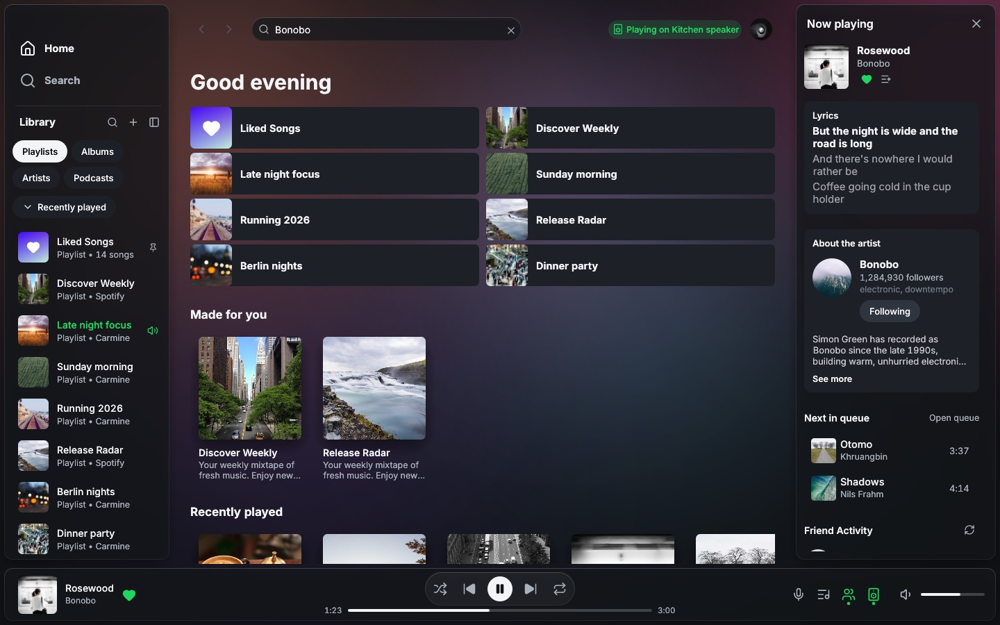
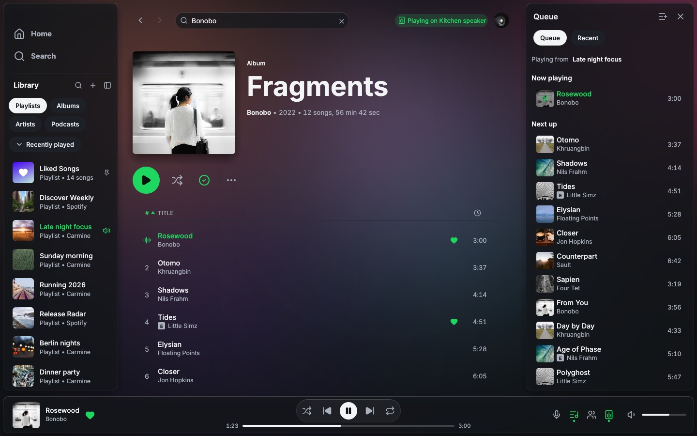
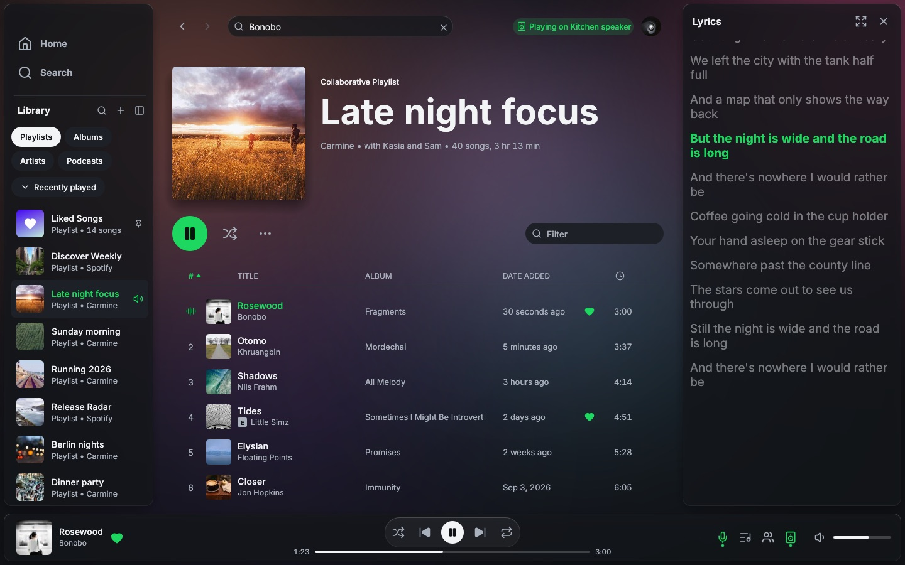
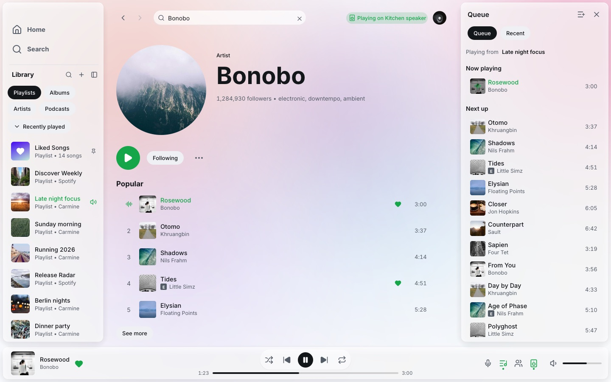
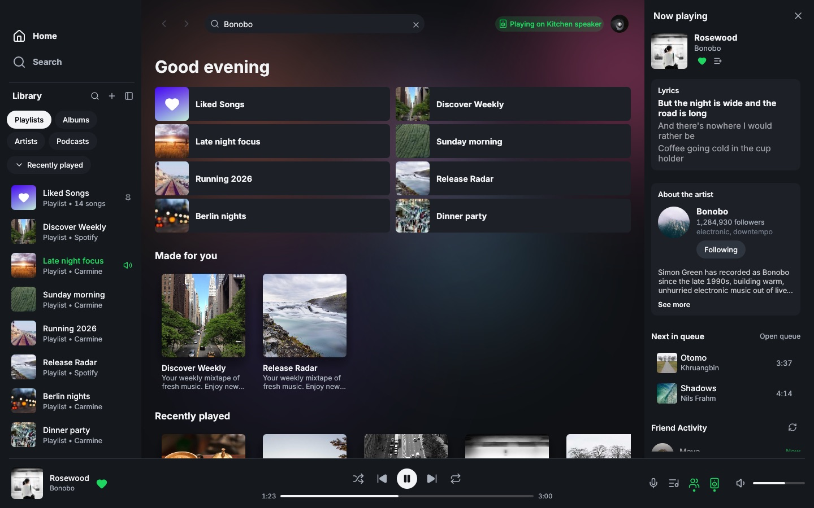
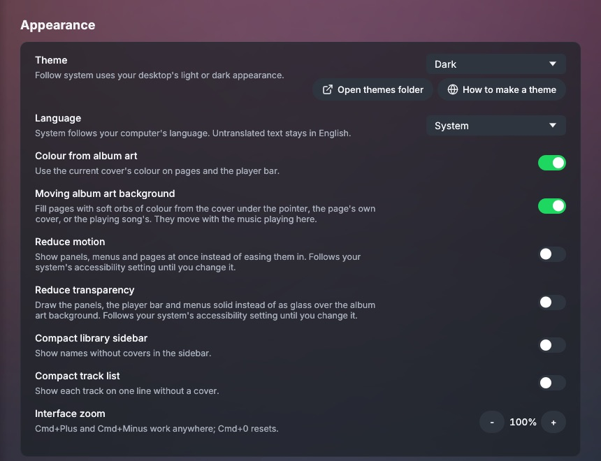

<p align="center">
  
</p>

<h1 align="center">Spotifast</h1>

<p align="center"><strong>Spotify, native and fast.</strong><br>A lightweight music app for Linux, macOS, and Windows.</p>

<p align="center">
  <a href="https://spotifast.rocks/download/"><strong>Download</strong></a> ·
  <a href="https://spotifast.rocks/getting-started/">Getting started</a> ·
  <a href="https://spotifast.rocks/using-spotifast/">User guide</a> ·
  <a href="CONTRIBUTING.md">Contribute</a>
</p>

<p align="center">
  <a href="Cargo.toml"></a>
  <a href="https://spotifast.rocks/download/"></a>
  <a href="LICENSE"></a>
</p>

## About this fork

This is a personal fork of [crmne/spotifast](https://github.com/crmne/spotifast).
It keeps everything upstream does and changes how the app looks and moves.
The rest of this README is upstream's and describes upstream's builds.



**What it adds**

- **Album art background.** The window is filled with soft orbs of colour
  taken from the cover art. The colours come from the page you are on, the
  card under the pointer, or the playing song. While music plays on this
  computer, the orbs grow, brighten and pulse with its loudness and beats.
  When paused they stand still and the app draws no frames.
- **Glass panels.** The sidebar, the side panels, the player bar, menus and
  dialogs float over the background as rounded, tinted glass. A test keeps
  the text on them at WCAG 4.5:1 contrast over any colour the orbs can take.
- **Motion.** Side panels and the sidebar slide, pages fade in, menus and
  dialogs fade, the player bar cross-fades between songs, and hover feedback
  eases in.
- **Accessibility switches.** Settings > Appearance has *Reduce motion* and
  *Reduce transparency*. Both follow the macOS accessibility settings until
  you change them.
- **Now playing and Friend Activity.** A right panel shows the playing song,
  the current lyric lines, an About the artist card, what is next in the
  queue, and what the people you follow are listening to. You can unfollow
  someone from there.
- **A tidier interface.** Sizes, corners and timings are named design
  tokens. Icon buttons, Play buttons and text buttons each come in a few
  fixed sizes. Lyrics, Queue, Friend Activity and Devices are toggled from
  one group in the player bar. Settings, the Winamp mini player and MilkDrop
  moved into the account menu.
- **Radio Nova.** The sidebar's *Radio Nova* row plays the Bulgarian
  station live through the same output, equalizer and visualisers as
  Spotify, with the song on air in the player bar. Advert breaks are
  muted from the station's own advert cue until the next song; the news
  stays on. Starting it pauses Spotify; playing anything from Spotify
  stops it.
- **Smaller changes.** New profiles start in the dark theme. On macOS a
  closed window stays in the Dock instead of the menu bar. The playlist
  library and Made for you load over the playback session when the shared
  Web API app is rate limited. The updater reads this fork's releases.

| | |
|---|---|
|  |  |
| Album page with the Queue | Playlist page with Lyrics |
|  |  |
| Light theme | Reduce transparency: solid panels, same background |



**Getting it.** This fork publishes no builds yet, so build it from source as
upstream describes below. On a Mac with a Developer ID certificate,
`packaging/macos/install-local.sh` builds, signs and installs it to
`/Applications`.

The screenshots come from the demo data, rendered without a window by
`cargo run --example render --features render` (see `examples/render.rs`).

---

Spotifast is a Spotify client written in Rust with
[egui](https://www.egui.rs) and [fastframe](https://fastframe.dev), the
framework behind a family of native desktop apps. It plays music through
[librespot](https://github.com/librespot-org/librespot), typically uses
100–250 MB of RAM, starts in well under a second, and has no browser engine.

The interface includes complete
[translations for all supported languages](docs/_reference/translating.md#languages-and-coverage).

**Playback needs Spotify Premium.** Free accounts can browse and search, but
cannot play music through Spotifast.


<details>
<summary><strong>Watch Spotifast in action</strong></summary>

https://github.com/user-attachments/assets/a5f669ce-b3b7-4f8e-9933-976a78876c7e

</details>

[Features](#your-music-on-your-desktop) · [Install](#install) · [First playback](#start-listening) · [Mini player](#the-winamp-mini-player) · [MilkDrop](#music-in-motion) · [Help](#guides-and-help)

## Your music, on your desktop

| Feature | What you can do |
|---|---|
| **Library and search** | Browse playlists, Liked Songs, albums, artists, and podcasts. Search the catalogue and edit playlists you own. |
| **Local files** | Play the local files your playlists list from a folder you choose in Settings, at any sample rate. |
| **Spotify Connect** | Play on this computer or control playback on your other devices, including Google Cast speakers and groups. Cast devices appear as they are discovered; frequently and recently chosen outputs rise to the top. Remote volume keeps your chosen level while Spotify updates. |
| **Queue** | Add songs to the queue, or choose **Play next** to put a song or selection first when playing on this computer. |
| **Themes** | Choose light, dark, system appearance, or custom colours, with one theme for light mode and one for dark mode that switch with the system. On Omarchy, follow your desktop theme. |
| **Desktop controls** | Use keyboard shortcuts and media keys. Keep music playing from the tray when supported by your desktop and settings, and start Spotifast with your computer, with its window or in the tray. |
| **Winamp mini player** | Use classic skins with an equalizer, playlist, and animated sound displays. |
| **MilkDrop** | Watch music-reactive visuals in a separate window or full screen. See platform availability below. |

## Install

| Platform | Installation |
|---|---|
| **macOS** | `brew install --cask crmne/tap/spotifast`, or [download the Mac app](https://spotifast.rocks/download/#macos). |
| **Arch Linux** | `yay -S spotifast-bin` |
| **Windows** | Choose your build on the [Download page](https://spotifast.rocks/download/). |
| **Other Linux** | Find Flatpak, AppImage, Nix, and other options on the [Download page](https://spotifast.rocks/download/). |
| **From source** | Follow [Build from source](https://spotifast.rocks/getting-started/#build-from-source) for dependencies and commands. |

## Start listening

1. Make your own free Spotify app, as the sign-in screen shows: in the
   [Spotify developer dashboard](https://developer.spotify.com/dashboard),
   create an app with the redirect URI `http://127.0.0.1:8989/login` and
   **Web API** ticked. Spotify requires Premium on the account that creates
   it. [Getting started](https://spotifast.rocks/getting-started/#make-a-spotify-app)
   has the steps.
2. Paste its Client ID into Spotifast and choose **Sign in with Spotify**.
   Approve access in your browser, then return to the app to see your library.
3. To listen on this computer, open the device menu in the bottom player bar
   and choose **Set up playback here**, also available in Settings.
4. Complete the separate playback approval in your browser. Your computer
   appears as a Spotify Connect device named **Spotifast**.

Library access and local playback have separate approvals. Spotifast remembers
both using your computer's protected storage. See
[Getting started](https://spotifast.rocks/getting-started/) for the full walkthrough
and [How it connects](https://spotifast.rocks/how-it-connects/) for the details.

## The Winamp mini player

A classic look for your music, with Winamp 2 `.wsz` skins, an equalizer,
a playlist, and animated sound displays. Switch with **Ctrl+M**
(**Cmd+Shift+M** on macOS), the shrink button, or Settings.
The spectrum analyser and oscilloscope also work in the collapsed title bar.

<p align="center">
  
</p>

[Explore the mini player](https://spotifast.rocks/winamp/), including skins,
window sizes, controls, and the return to the main player.

## Music in motion

MilkDrop reacts to music playing on this computer, with more than 10,000
presets downloaded on first use. Open it from the visualiser button,
Settings, or the mini player's **V** menu.


Included on **Linux**, **macOS**, and **Windows Intel/AMD** builds.
It is not included in the Windows on ARM download.
[Read the MilkDrop guide](https://spotifast.rocks/milkdrop/) for presets,
controls, and fullscreen mode.

## Guides and help

The complete guide lives at **[spotifast.rocks](https://spotifast.rocks/)**.

| You want to… | Read |
|---|---|
| Sign in, set up playback, or configure themes, fonts, and proxies | [Getting started](https://spotifast.rocks/getting-started/) |
| Learn shortcuts, command-line controls, and updates | [Everyday use](https://spotifast.rocks/using-spotifast/) |
| Find configuration and stored files | [Settings and files](https://spotifast.rocks/settings-and-files/) |
| Understand scrolling performance and reduce loading delays | [Make it even faster](https://spotifast.rocks/make-it-even-faster/) |
| Fix "Spotify refused the audio key" or "Spotify is being slow" | [When something goes wrong](https://spotifast.rocks/troubleshooting/) |
| Understand what is stored and sent | [Privacy](https://spotifast.rocks/privacy/) · [How it connects](https://spotifast.rocks/how-it-connects/) |
| Check Spotify and librespot limitations | [What Spotify allows](https://spotifast.rocks/what-spotify-allows/) |
| Understand account risk | [Will my account get banned?](https://spotifast.rocks/what-is-spotifast/#will-my-spotify-account-get-banned) |
| Report a bug or propose a feature | Read [Contributing](CONTRIBUTING.md), then use the [issue forms](https://github.com/crmne/spotifast/issues/new/choose). |

## Contributing

Read [CONTRIBUTING.md](CONTRIBUTING.md) before opening an issue or pull
request. To look at the interface without a Spotify account, run:

```sh
cargo run --features demo -- --demo
```

Translations live in `assets/i18n/`; see
[Translating Spotifast](docs/_reference/translating.md). Release packaging
is described in [PACKAGING.md](PACKAGING.md).

## More native apps

**Want WhatsApp just as fast and native?** [ZapFast](https://zapfast.rocks)
is Spotifast's sibling. Both are built on
[fastframe](https://fastframe.dev).

## Sonos playback

Sonos speakers use the Spotify Connect session for playback control. Enable
local playback first, then select the speaker in the device picker.

## Acknowledgements

Spotifast uses [librespot](https://github.com/librespot-org/librespot),
[egui](https://www.egui.rs), [fastframe](https://fastframe.dev), the [Inter](https://rsms.me/inter/)
typeface (OFL), and [Lucide](https://lucide.dev) icons (ISC).

Spotifast is an independent project and is not affiliated with Spotify.
Spotify is a trademark of Spotify AB.

Licensed under the [MIT License](LICENSE).

## Star history

<a href="https://www.star-history.com/?repos=crmne%2Fspotifast&amp;type=date">
  <picture>
    <source media="(prefers-color-scheme: dark)" srcset="https://api.star-history.com/chart?repos=crmne/spotifast&amp;type=date&amp;theme=dark">
    
  </picture>
</a>
